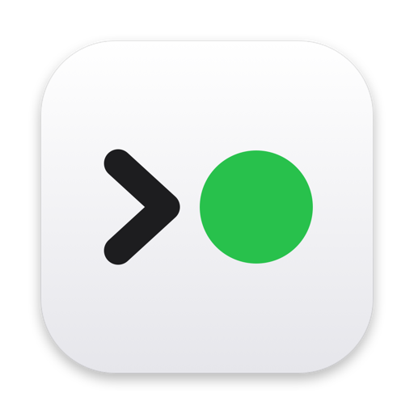
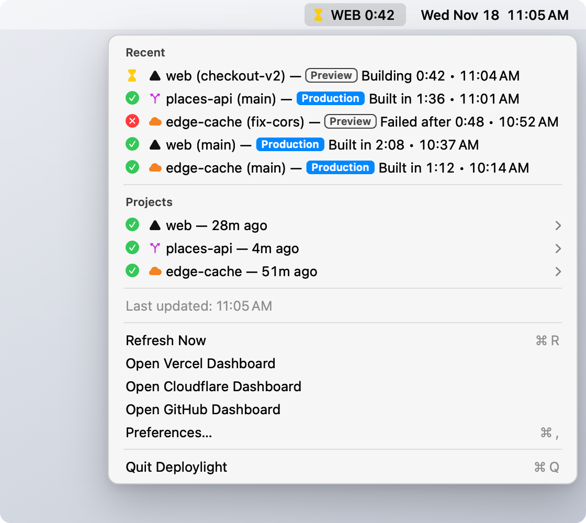
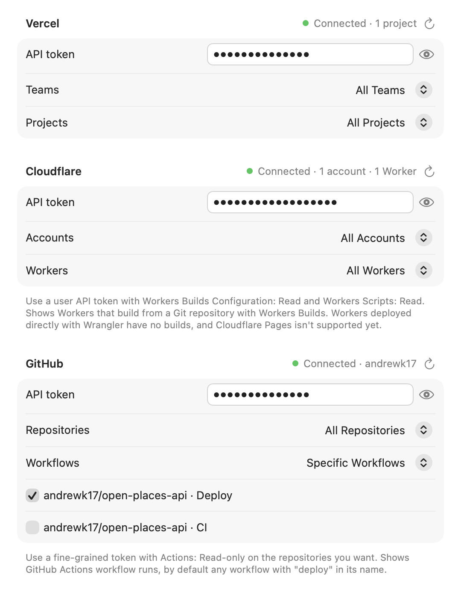

# Deploylight

**Deploy status in your Mac menu bar, for Vercel, Cloudflare and GitHub Actions.**

Deploylight is a free, open-source macOS menu bar app that shows Vercel deployments, Cloudflare Workers Builds and GitHub Actions runs as they build, succeed or fail. It lists them together, newest first. Its icon follows the latest one, and clicking a row opens it in its provider.

[**Download for macOS**](https://github.com/andrewk17/deploylight/releases/latest) · [Website](https://deploylight.andrewkim.me/) · [Release notes](https://github.com/andrewk17/deploylight/releases)

<picture>
  <source media="(prefers-color-scheme: dark)" srcset="docs/img/deploylight-menu-bar-dark.png">
  
</picture>

## Install

1. Download the [latest release](https://github.com/andrewk17/deploylight/releases/latest), unzip it, and move Deploylight to your Applications folder.
2. Open it, click its icon in the menu bar, and choose **Preferences…**.
3. Under **Accounts**, paste a token for each provider you use. Changes save automatically.

Deploylight needs macOS 13 or later. It's code-signed and notarized, and it stores your tokens in the macOS Keychain.

## Connect a provider

<picture>
  <source media="(prefers-color-scheme: dark)" srcset="docs/img/deploylight-accounts-dark.png">
  
</picture>

Add one provider or all three. Deploylight only reads from them, and the Cloudflare and GitHub tokens below are read-only. After you paste a token, **Accounts** shows whether it connected and lists what it can see, so you choose teams, projects, Workers, repositories and workflows from a list.

### Vercel

1. Open [Vercel Account Settings → Tokens](https://vercel.com/account/tokens) and create a token.
2. For the scope, pick your personal account or the team you want to watch.
3. Copy the token right away. Vercel shows it only once.

### Cloudflare

Deploylight shows Workers that build from a GitHub or GitLab repository with [Workers Builds](https://developers.cloudflare.com/workers/ci-cd/builds/).

1. Open [My Profile → API Tokens](https://dash.cloudflare.com/profile/api-tokens) and choose **Create Custom Token**.
2. Add two **Account** permissions: **Workers Builds Configuration: Read** and **Workers Scripts: Read**.
3. Under Account Resources, include the accounts you want to watch.

The token must be a **user** API token, created from your profile. Account-owned tokens can't read Workers Builds. Cloudflare Pages projects aren't supported yet.

Builds of a Worker's production branch show as **Production**. Builds of other branches and pull requests show as **Preview**.

### GitHub Actions

Use this for anything that deploys from a workflow. That includes Workers shipped with `wrangler deploy`, which never create a Workers Build.

1. Create a [fine-grained personal access token](https://github.com/settings/personal-access-tokens/new).
2. Select the repositories to watch and grant **Actions: Read-only**. GitHub adds **Metadata: Read-only** itself.

A classic token or a GitHub CLI token with the `repo` scope also works.

By default, Deploylight shows runs of workflows with `deploy` in their name or file path. To watch others, switch **Workflows** to **Specific Workflows**. Runs started by a release, and GitHub Pages builds, show as **Production**. So do runs on the default branch started by a push, a manual run, a schedule or another workflow. Other runs show as **Preview**, including pushes to a tag.

## Reading the menu

**The menu bar icon** follows a build that's running, or otherwise your latest deployment: an hourglass while it builds, a green check when it's ready, a red cross when it failed. While a build runs, the project and build time appear next to it.

**Recent** lists deployments from every connected provider, newest first. Each row has:

- the provider: a triangle for Vercel, a cloud for Cloudflare, a branch for GitHub
- the project and branch
- a filled **Production** badge or an outlined **Preview** badge
- the build time ("Building 1:12", then "Built in 2:56" or "Failed after 0:48") and when it started

**Projects** shows each project's latest production deployment, with its recent history in a submenu.

Click any deployment to open it in its provider.

## Preferences

| Tab | What you can change |
| --- | --- |
| **General** | Whether the project and build time show next to the icon (while building, always or never), the time format, opening at login, the update check, and how often to refresh |
| **Menu** | How rows mark the provider and environment, how many recent deployments to list and from how far back, and whether to show Projects |
| **Accounts** | Your tokens, and which teams, projects, accounts, Workers, repositories and workflows to show |
| **Filters** | Production or preview, deployment states, and git branches |

## FAQ

<details>
<summary>How do I see Vercel, Cloudflare or GitHub Actions deploys in the macOS menu bar?</summary>

Install Deploylight and paste a token for each provider under **Preferences → Accounts**. It polls each provider and updates its menu bar icon as your deployments build, succeed or fail.
</details>

<details>
<summary>Why don't my Cloudflare Workers show up?</summary>

Check that:

- The Worker builds with [Workers Builds](https://developers.cloudflare.com/workers/ci-cd/builds/), meaning it's connected to a GitHub or GitLab repository in the Cloudflare dashboard. Workers deployed with `wrangler deploy` from your machine or another CI have no builds to show.
- The token is a **user** API token from your profile, with **Workers Builds Configuration: Read** and **Workers Scripts: Read**, and it includes the Worker's account.
- It's a Worker, not a Cloudflare Pages project. Pages isn't supported yet.

**Preferences → Accounts** shows whether the token connects and lists the Workers it can see.
</details>

<details>
<summary>My Cloudflare Workers deploy from GitHub Actions. How do I see them?</summary>

Add a GitHub token under **Preferences → Accounts → GitHub** with read access to Actions on the repository. If the workflow's name or file path contains `deploy`, it appears with the default **Deploy Workflows** setting. Otherwise, choose **Specific Workflows** and select it. The menu shows the run's status and opens the run when clicked.
</details>

<details>
<summary>Do I need my Vercel Team ID?</summary>

Usually not. Preferences lists the scopes your token can access, so you pick teams from a list instead of typing IDs.
</details>

<details>
<summary>I used Vercel Deployment Menu Bar. Do I need to set things up again?</summary>

No. Deploylight is the same app under a new name, and it keeps your settings. Move Deploylight to your Applications folder and open it. It offers to quit the old "Vercel Deployment Menu Bar" app and move it to the Trash.
</details>

<details>
<summary>macOS says the app is damaged. What do I do?</summary>

Releases since v0.2.0 are code-signed and notarized, so this shouldn't happen. If it does:

1. Download the [latest release](https://github.com/andrewk17/deploylight/releases/latest) again.
2. If the error persists, right-click the app and choose **Open** instead of double-clicking.
3. For versions before v0.2.0, remove the quarantine attribute: `xattr -d com.apple.quarantine "/Applications/Vercel Deployment Menu Bar.app"`
</details>

## How it works

Deploylight calls each provider's API straight from your Mac and merges the results. By default it checks every 15 seconds, and every 2 seconds while something is building.

- **Cloudflare:** each refresh asks for the latest build of up to 20 Workers per request. A Worker's build history is downloaded again only when its latest build changes.
- **GitHub:** it watches up to 30 workflows, starting with the most recently pushed repositories. Conditional requests reuse unchanged run history without drawing down GitHub's rate limit, and repository and workflow lists are cached between polls.

An optional daily check adds a link to the menu when a newer release is out. It never downloads or installs anything.

## Build from source

You need macOS 13 or later, Xcode 15 or later, and Swift 5.9 or later.

```bash
git clone https://github.com/andrewk17/deploylight.git
cd deploylight
swift test
./Scripts/package-app.sh   # creates build/Deploylight.app
```

[CONTRIBUTING.md](CONTRIBUTING.md) covers signing, notarization, the screenshots and the website.

---

Made by [Andrew Kim](https://andrewkim.me). Released under the [MIT License](LICENSE). Formerly Vercel Deployment Menu Bar.

Deploylight is not affiliated with or endorsed by Vercel Inc., Cloudflare, Inc. or GitHub, Inc. Their names are trademarks of their respective owners.
